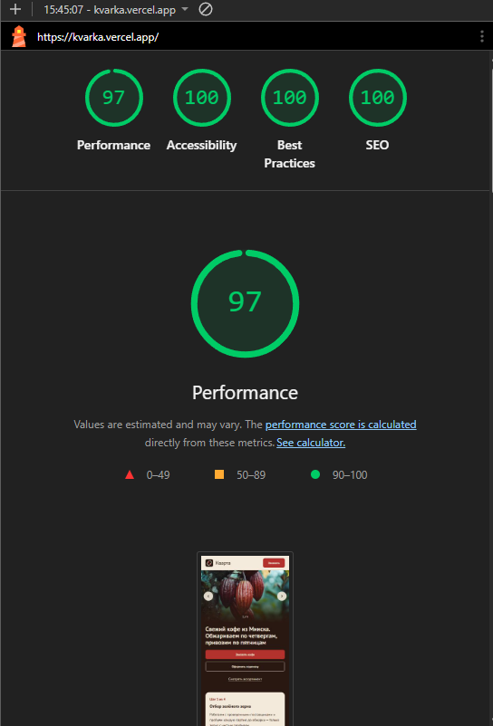

## Запуск

```bash
npm run dev
```

### Создание базы

Мы создаем лендинг для небольшой ремесленной обжарки кофе «Кварта» в Минске. 
Стек: Next.js (App Router), TypeScript, Tailwind CSS.

Требования к стилю и дизайну:
- Тёплый, простой, крафтовый тон (без пафоса, без глянцевых фиолетовых неоновых градиентов).
- Цветовая палитра: глубокий кофейный/шоколадный (#2C1810 или около того), тёплый молочный/кремовый фон (#F9F6F0), акценты терракотовые или приглушенно-оливковые.
- Типографика: чистая, сбалансированная.

Создай следующие структуры и файлы:
1. Файл констант `src/data/coffee.ts` со следующими данными из ТЗ:
   - Сорта зерна: 
     * Эфиопия Иргачефф (цветочный, бергамот, светлая обжарка · 250 г — 32 BYN)
     * Колумбия Уила (карамель, красное яблоко · 250 г — 29 BYN)
     * Бразилия Серрадо (орех, шоколад, под эспрессо · 250 г — 26 BYN)
   - Дрип-пакеты: Ассорти, 10 штук — 18 BYN
   - Подписка: 2 пачки по 250 г раз в месяц, доставка бесплатно — 54 BYN / мес
   - Информация о компании: основатели Аня и Дмитрий (бывшие бариста), обжаривают партиями по 5 кг с 2019 года, обжарка по четвергам, развоз по пятницам. Зерно на 1–3 день после обжарки.
   - Адрес: Минск, ул. Короля, 9 (самовывоз). Время: пн–пт 8:00–20:00, сб–вс 10:00–18:00.

2. Сделай базовую верстку главной страницы (`src/app/page.tsx`) со следующими секциями:
   - Hero-секция (заголовок про свежесть, обжарку по четвергам, призыв к заказу).
   - Блок «Кто мы и почему свежесть важна» (история Ани и Дмитрия, ул. Короля 9).
   - Блок «Ассортимент и подписка» (карточки товаров из констант).
   - Блок «Доставка и самовывоз» (условия: пятница, от 50 BYN бесплатно, самовывоз с Короля).
   - Секция с формой заявки (поля: Имя, Телефон, Что интересует: подписка / разовый заказ / вопрос, Комментарий).
   - Футер с контактами.

Напиши чистый, рабочий код без заглушек.

Нам нужно реализовать бэкенд для формы заявки на лендинге кофе «Кварта».

Создай / обнови следующие файлы:

1. Файл `src/app/api/lead/route.ts` (Next.js App Router API Route):
   - Эндпоинт: POST /api/lead
   - Ожидаемые данные в body: 
     {
       name: string, 
       phone: string, 
       type: 'subscription' | 'order' | 'question', 
       comment?: string,
       utm?: {
         source?: string,
         medium?: string,
         campaign?: string,
         content?: string,
         term?: string,
         referrer?: string
       }
     }

   - Требования к бизнес-логике:
     1. Валидация телефона (Беларусь):
        - Убираем все лишние символы (пробелы, тире, скобки).
        - Номер должен соответствовать формату РБ: префиксы +375 или 80, операторы 29, 25, 44, 33 и ровно 7 цифр после них (всего 12 или 11 цифр).
        - Если формат неверный, возвращаем status 400 и понятную ошибку: "Укажите верный белорусский номер телефона (+375 XX XXX-XX-XX)".
     
     2. Защита от дублей (10 минут) и быстрого повторного клика:
        - Реализуй in-memory хранилище (Map<string, number>), где ключ — очищенный номер телефона, значение — timestamp последней заявки.
        - Если с момента последней заявки прошло меньше 10 минут, возвращай status 429 и сообщение: "Заявка с этого номера уже принята. Менеджер свяжется с вами в ближайшее время."

     3. Сохранение заявки локально (для выполнения ТЗ):
        - Сохраняй заявки в файл `data/leads.json` (создавай директорию и файл, если их нет). Каждая заявка включает timestamp, имя, телефон, тип, комментарий, utm-метки.

     4. Дублирование в Telegram-бот (Бонус из ТЗ):
        - Читай из process.env переменные TELEGRAM_BOT_TOKEN и TELEGRAM_CHAT_ID.
        - Если переменные заданы, отправляй аккуратное Markdown-сообщение с деталями заявки и UTM-метками в Telegram через fetch к https://api.telegram.org/bot<TOKEN>/sendMessage.
        - Добавь try/catch на отправку в Telegram, чтобы ошибка ТГ не валила основной ответ сервера.

     5. Возвращай аккуратные JSON-ответы с соответствующими HTTP-статусами (200, 400, 429, 500).

2. Создай пример файла `.env.example`:
   TELEGRAM_BOT_TOKEN=your_bot_token_here
   TELEGRAM_CHAT_ID=your_chat_id_here

   3. Toast-уведомления (вместо изменения текста страницы):
   - При успешной отправке заявки или при ошибке (включая 429 дубль или 400 неверный номер) **не менять** структуру страницы.
   - Показывать красивое плавающее уведомление (Toast / Alert) в углу экрана (например, справа сверху или снизу):
     * Успех: зелёный фон/рамка, сообщение «Заявка успешно отправлена! Менеджер свяжется с вами».
     * Ошибка / лимит: красный/терракотовый фон, текст ошибки от бэкенда.
   - Уведомление должно автоматически исчезать через 4–5 секунд или закрываться по крестику.

   Сделай редизайн секций лендинга, чтобы он не выглядел пустым и разреженным:

1. Hero-секция:
   - Исправь заголовок, чтобы он не обрезался слева и выстраивался в красивую сетку (например, крупный акцентный заголовок: «Свежий кофе из Минска. Обжариваем по четвергам, привозим по пятницам»).
   - Добавь на фон Hero-секции текстурный или градиентный кофейный подложечный слой (глубокий шоколадный оттенок с мягким теплым свечением), чтобы она не выглядела пустой бежевой стеной.
   - Сделай отступы (padding) более сбалансированными.

2. Секция карусели («От зерна до вашей чашки»):
   - Карточка карусели сейчас теряется. Сделай её на контрастном фоне (например, темно-кофейный блок с кремовыми карточками внутри или наоборот).
   - Добавь больше визуальных деталей: плашки «Свежесть 1-3 дня», иконки или акцентные теги.

3. Общий визуальный стиль:
   - Увеличь контраст текста (основной текст сделай темнее, ближе к глубокому шоколадному #2C1810, а не бледному).
   - Добавь разделители или чередование фонов секций (одна секция кремовая, следующая — чистый белый или глубокий кофейный), чтобы лендинг ритмично сменял блоки, а не сливался в одну полосу.

### Дальше перешел в claude web
Основа для дизайна и логики была готова, токены в курсоре закончились, но смысла дальше его использовать и не было, так как claude пишет лучше

Из важного были провки дизайна
```text 
   Привет, нужно исправит дизайн сайта. 2 градиента друг в друга ударяются. Текст в овалах почти не читаем. К сожалению, я не разбираюсь в дизайне чтобы сделать красиво, но я понимаю достаточно чтобы сказать что плохо - и это очень плохо. Почему он сделал только 2 блока, 2 блока градиента друг в друга ударяются, маленький текст, шрифт можно поменять, добавить еще картинок, карусель сделать больше и вообще 1 блоком
```
```text
Другие блоки тоже нужно доработать, поработать с контрастом и цветами
Можно также поработать со шрифтом и цветами
```
```text
Мне кажется, или модальное окно слишком сливается с фоном, либо фон сделать темнее, выскажи свое мнение
```
```text
Мне не очень нравиться форма, нужно убрать боковой ползунок, что-то сделать с границами элементов, и не знаю, то ли цвета как-то не работают то ли они слишком большие, ощущение не знаю, формы для аутистов или на смартфонах, ну понятно mobile-first для телефонов большие кнопки норм, но на компьютере с большим монитором, или это чисто из-за моего большого монитора и только full hd
```
```
Ладно, спасибо, вроде форма нормальная, если что еще вернемся к ней. Помоги с этими 2 блоками, я понял в чем проблема, я все смотрел на них и думал, почему они ощущаются пустыми - нет картинки товара, добавь заглушки ведущие в ту же папку public, где будут будущие картинки. Вот доставка и самовызов не знаю что с ними делать пока что
```
Дальше пошел бек, оставлять в файловой системе нельзя было, так как в vercel нет возможности работать с файловой системой, был подключен redis для сохранения заявок. Также через атомарные операции в redis был реализован механизм отсчета 10 минут

```text
Я тебе не отправлял вроде как бек сайта. Как видишь, там идет parseUml для ссылки, есть заглушка для телеграма, чтобы его доделать и да, отчет 10 минут идет через объект map, то есть у каждого номера свое время, а не какие-нибудь куки файлы. Хранение данных в файле, как по заданию, но и в правду можно докрутить базу данных 
```
Дальше уже были доработки, создал бота, добавил id чата и бота, проверил, как смотриться дизайн на телефоне
```text
Хорошо, но есть недочет, на телефонах не видно на 1 экране кнопки и картинку, можно сделать свайпы вправо и влево для следующего слайда, но будет проблема с самими свайпами на телефоне, то что может перекинуть на страницу назад, так что лучше на телефонах кнопки перелистывания разместить сбоку от картинок
```
```text
Может icon еще и в header закинуть?
```
И проверка перформанса в lighthouse


В целом с бек стороной проблем не было, основные правки были в дизайне, на свой взгляд оценивал и менял. Бек немного переписывал из-за файловой системы и системы контроля 10 минут. 
